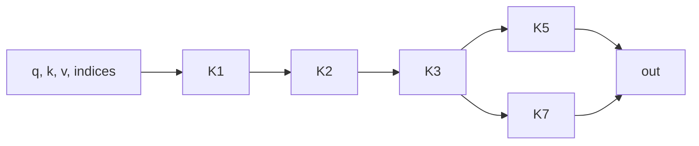

# 可视化 v2：以里程碑为中心

> 状态：**第 1 期已实现**（`mf ms …`，另把第 2 期的 bootstrap M0 和用例变更通道的最小版提前了，以支持新算子开发）；第 2–4 期待做，
> 实现与本文的差异见 §9。按你的选择：入口文档放产品仓库算子目录；GitHub 上只推分支 + tag；推送首次问你、之后自动。
> v1 的 L0–L3、gate、预警、复核全部保留，本方案在其上加一层“里程碑”。
> 证据来自 `/opt/lc/pyhip`（tingqli/pyhip 的 PR、QSA / GRRead / MoE 的文档与测试）和 myflow 现有代码。
> 阅读：§0 约 1 分钟；全文约 15 分钟。

## 0. 一屏摘要

- **问题**：v1 看板以“尝试”为中心，回答“数字可信吗、卡住了吗”；回答不了你最关心的三件事——
  **进展到哪、已提交的改了什么及原理、方向偏没偏**。pyhip 的现场：PR 大（#57 +9.6k 行 / 38 文件 / 14 轮 review），
  文档全但长（QSA readme 233 KB），用例缺口靠 review 才发现（#62 的 BQ21/BQ42、logits 分块边界）。
- **方案**：开发切成**里程碑**——每个是一个可独立评审的完整改动（默认一轮一个，编号独立于轮次）。收尾默认只派 **1 个独立复核**
  （精简流程，11-21 用户决定）：核对并补齐入口文档的本里程碑一节（做了什么 · 为什么 · 与计划 / 上游的差异 · 已知问题）、测试覆盖表和卡片，
  补上缺的用例，发现问题直接改、不打回，只做一次。（旧的三角色——测试负责人 → 文档作者 → 冷读验证者——已于 11-22 删除，见 §9.1“裁剪”。）
  然后 mf 组装最终提交，**在这个提交上**重新验收（性能型与上一里程碑做同卡 ABBA），
  打 tag 推送到你批准的 fork，并写明**下一步承诺**（或“完成 / 等你决定”）。
- **你看到的**：

| 你想知道 | 看哪里 | 用时 |
|---|---|---|
| 进展 | 看板顶部 / 分支上入口文档的**路线图**（✅ 已推送 · 🔄 进行中 · ⏳ 已承诺） | 30 秒 |
| 已提交的改了什么、有没有偏差 | **里程碑卡**（提交信息 / 看板 L2）：做了什么 · 为什么 · 与计划的差异 · 覆盖 · 已知问题 · 性能 · 下一步 | 每个 3 分钟 |
| 方向偏没偏 | **方向检查**（目标表 + 8 个信号），尤其“上次承诺的下一步 vs 这次实际做的”“预期收益 vs 实测” | 1 分钟 |
| 可靠性（不看代码） | **统一入口文档**的测试覆盖表：情况 → 用例 → 结果，外加未覆盖 / 跳过清单；另有接口与行为、各里程碑一节 | 5 分钟 |

- **发现问题的三个时点**：开工前（计划卡 gate：预期收益与依据不对，当场否掉）· 进行中（v1 看板：卡住、虚报、停滞）·
  收尾后（里程碑卡 + 方向检查：做的是不是该做的）。
- **独立性不靠自觉**：复核与实现者是不同的子 agent 会话；mf 按路径限制它能改的文件（只能改文档和用例，不能改运行时代码），
  收尾时校验推送的运行时树与验收的候选相同，并在最终提交上重跑功能用例。
- **落地**：myflow 加约 1.3k 行（stdlib），分 4 期；第 1 期（里程碑卡 + 双基线数字 + 推送 + 路线图 + 基本方向信号）已能回答上面前三问。
  已确认的决定见 §10，第 1 期的实际实现见 §9.1。

## 1. 现状与证据

### 1.1 v1 看板能答什么、不能答什么
| 你的问题 | v1 现在 | 缺口 |
|---|---|---|
| 进展 | 阶段条、尝试/预算、按尝试序号的性能轨迹 | 没有“完成了哪几件事”的单位；几十个尝试点不等于进展 |
| 提交了什么 | L2：一句 idea + diffstat + 逐 case 数字 | 没有原理、接口变化；lane 分支只在本地，GitHub 上看不到 |
| 原理 | brief ≤600 字（过程叙述） | 没有设计文档（接口、tile、流水线）；REPORT 只在最后生成 |
| 方向 | 停滞、超时、虚报、目标被改等预警 | 只防“卡住和作弊”，不防“做的不是该做的”：没有计划 vs 实际、承诺 vs 兑现 |
| 测试 | correctness / bench 冻结为 oracle | 没有用例清单与覆盖关系；冻结后合法新增用例也会被判 `oracle_modified`；新算子在基线上正确性无法通过 → 无法 freeze |

### 1.2 pyhip 的算子结构（沿用其内容，改造其形态）
```
src/pyhip/ops/<op>/flydsl/*.py       kernel + host（公共入口、dispatch）
src/pyhip/ops/<op>/flydsl/readme.md  “实现与优化记录”：§0 术语 · 调用链表（kernel｜grid×block｜LDS｜作用）·
                                     伪代码（链接到代码行）· §4 文件/接口/限制/数据来源 · §5 优化历史（改动、结果、证据；含“评估过但未采用”）
tests/ops/<op>/                      功能用例；pytest 默认 -m "not perf"，性能用例用 perf marker 显式选择
benchmarks/<op>/readme.md            使用方法、最终性能、验收状态、接入示例（#56 review 要求的结构）
mytest/mydata/...                    原始数据、trace、冻结源码，不改写
```
调用链表、伪代码、限制、证据链这些**内容**已经接近你要的设计文档；问题在**形态**：

### 1.3 痛点（证据）
| 痛点 | 证据 |
|---|---|
| 改动单位太大，只能整体 review | #57 +9633 行 / 38 文件 / 19 提交 / 14 轮 review；#62 +7199/−3299、13 轮；#64 +12758 行 / 28 文件 / 3 提交 / 0 review |
| 文档全但读不快 | QSA `flydsl/readme.md` 233 KB + `todo.md` 92 KB + `benchmarks/qsa/readme.md` 69 KB；§5 每条历史是一段数百字的高密度文字 |
| 用例缺口靠 review 发现 | #62：Copilot 指出 BQ21/BQ42 变体无 pytest 覆盖、prefill 用例没跨 logits 分块边界、跨窗口 union 成员未校验 → 之后才补 `h6-bq21/h3-bq42` 与 `test_prefill_logits_chunks` |
| 接口/范围/限制在 review 里才对齐 | #57：要求“对齐 stable api、scope 和 limitation”；#56：要求把性能脚本移到 benchmarks、readme 写性能数据与代码示例 |
| 里程碑其实存在，但看不见 | #62 之后的 FP8 系列（11-10～11-18）27 个提交（17 个 `[fly]` 代码提交、10 个文档/数据提交），readme §5 已按日期分成 7 段——天然的里程碑；但没有每段的“性能 Δ / 原理 / 下一步”，下一步只在对话里（“按第 1–5 项依次优化”） |

## 2. 核心：里程碑

**定义**：一个可独立评审的完整改动——一个主题；分支全绿（功能用例全过）；入口文档已更新并通过冷读；
有性能主张的已复核；默认 ≤800 行非测试、非生成改动，≤1 天（超出需写原因，显示在卡片上）。

| 类型 | 验收 | 例 |
|---|---|---|
| 功能 | 新覆盖项都有用例且通过；接口写进文档 | FP8 K/V 功能版 |
| 性能 | 最终提交 vs 上一里程碑的同卡 ABBA 为 improved，且无 case 回退超阈值 | union tile 拆成核心＋残余 |
| 分析 | 结论 + 证据（ATT/PMC/上界实验），并给出下一步取舍 | 为什么 FP8 达不到 2× BF16 |
| 维护 | 功能用例全过、性能不回退（同样对上一里程碑） | 同步上游 AITER #6576 |

**两个基线，各管一件事**：
- **增量**（验收用）：`M_{k−1} ↔ M_k` 的同卡 ABBA。v1 的复核只对冻结基线比较——一个空改动也会继承前面里程碑的收益而被判 improved，所以不能用于验收。
- **累计**（防作弊锚，v1 不变）：对冻结基线的加速比，画在性能阶梯上。重新冻结（例如性能用例变了）开启新的 `baseline_epoch`，
  阶梯图按 epoch 分段，不跨 epoch 相乘。

**与 v1 的关系**：
- 里程碑编号独立于轮次；默认一轮一个。轮次 R_k 的 `plan` gate 批准本轮的**计划卡**；`integrate` 阶段变成**收尾**。
- 一轮里有多条有效 lane 时，第二个及以后的里程碑要把该 lane cherry-pick / 合并到当前 tip（v1 的 int lane），
  **在组合后的树上重新验收**，不能直接拿 lane 自己的复核结果。
- 一轮没有产出 → 计划中的里程碑标 dropped（本身就是走偏信号，会显示）。
- **新算子：bootstrap M0**。现有流程走不通（`mf lane new` 要求先 freeze，freeze 又要求基线上正确性通过），所以单独定义：
  在 bootstrap worktree 里做出功能正确版 + 测试计划 + 文档骨架 → 功能验收 + 冷读 → 提交 M0 → 以 M0 为基线 freeze。
  竞品 / 参照实现（Triton、BF16 路径等）作为参照列显示。
- 层级：Task → **Milestone** → Attempt → Run；看板：L0 全部任务 → L1 路线图 → **L2 里程碑** → L3 尝试 → L4 原始。

## 3. 流程

```
spec ─gate→ [新算子：bootstrap M0 → freeze] → survey →
 ┌→ plan R_k（计划卡）─gate→ implement（lanes ∥，lane 不改用例）⇄ verify → 收尾 M_k ──────────────────┐
 │                        测试负责人 → 文档作者 → 冷读验证 → 组装最终提交 → 在它上面验收 → tag + push │
 └────────────────────────────────────── 未达标且预算未尽 ─────────────────────────────────────────────┘ → report
```

### 3.1 计划卡（plan gate，每个里程碑 ≤10 行）
标题 · 类型 · 服务的 SPEC 目标（G1/G2…）· 验收标准 · **预期收益与依据**（上限/ATT/Amdahl）· 改动范围（模块）·
新增覆盖项 · 预计用时。测试负责人先为新增覆盖项写用例（测试先行），经 `oracle.accept` 提交到集成分支；lane 从这个提交开始，仍然不能改用例。

### 3.2 implement / verify
不变：lane、`mf try`、`mf verify`。唯一调整：lane 的越界 / oracle 检查以**它起点的里程碑**为准（否则里程碑里合法加入的文档和用例，
会让之后每次尝试都被判越界）；加速比分母仍是冻结基线。

### 3.3 收尾（新）：先成树，后验收
> 11-21 起默认走精简流程：下面第 2–4 步合并成 **1 个复核**（skill `myflow-review`，只做一次，改文档和用例、不打回），见 §9.1“精简流程”。
> 下面第 2–4 步的三角色写法已于 11-22 删除（见 §9.1“裁剪”），保留在这里只作设计历史。

1. **选定候选并立即做增量验收**：性能 / 维护型的候选须已有 `mf verify`（对冻结基线，给出累计值），再做 `M_{k−1} ↔ 候选`
   的同卡 ABBA（增量），不过就不进入收尾（省下三个角色的工夫）；功能型 = 功能用例全过的尝试。
   候选的**运行时树**（文档、测试路径以外的全部文件）从此固定，记录其哈希。
   `mf ms prep` 把候选放进集成 worktree，并打印 3 个角色的子 agent prompt（与 `mf lane new` 打印 lane prompt 的做法一致）。
2. **测试负责人**：覆盖审计——缺失阻断，冗余只提示；只能改测试路径；性能用例不动（要动走 gate + 重冻）。
3. **文档作者**：只根据 diff、代码、mf 数据更新入口文档的手写部分，写里程碑卡；只能改文档路径。`mf doc render` 填生成块。
4. **冷读验证者**：先闭卷只读入口文档 + 卡片答冷读题，再开卷对照代码、用例、mf 数据判对错；只以 5 道核心题判定通过，最多 2 轮（11-21 用户规则）；不改任何文件。
   不过 → 回文档作者（≤2 轮）→ 仍不过就问你。
5. **`mf ms close`**：
   - 组装最终提交（父 = 上一个里程碑，默认压成 1 个），校验其运行时树哈希与第 1 步相同，否则拒绝——因此第 1 步的 ABBA 结果对最终提交有效；
   - 在**最终提交**上重跑功能用例（测试负责人可能加了用例）；
   - 通过后写固定格式提交信息、打 tag `<task>-M<k>`、原子推送；卡片引用最终提交的哈希、运行时树哈希和验收编号。
   - **必须写明下一步**：1 个承诺 + 0–2 个暂定，或显式终态 `done / report / stop / await-user`；都没有则拒绝。
6. 下一轮 lane 以 M_k 为起点。

### 3.4 粒度规则
- 能用一句话 + 一段 ≤20 行的伪代码 diff 讲清；超出行数预算 mf 预警“该拆了”。
- 不同主题不混：同步上游、新 kernel、接入入口、调度优化各自成里程碑。
- 大的新 kernel 也能拆：QSA FP8 当时就是“union kernel → direct kernel → 入口接受 FP8 → bench”分开提交的。
- 附录 A 用 QSA FP8 系列演示怎么切。

## 4. GitHub 上看到什么

- **分支**（在你的 fork，只追加，不 force-push）：一个里程碑一个提交 + tag；`compare/<task>-M2...<task>-M3` 就是该里程碑的全部改动；
  提交信息就是卡片的纯文本版，所以**只推分支 + tag 就能在 GitHub 上看完已完成的里程碑**。lane 的快照提交（`A7: idea`）留在本地，不推送。
- **入口文档**在分支上直接浏览（GitHub 渲染 Markdown 表格与 Mermaid），顶部就是路线图和“下一步”。
- **可选的 draft PR**（建在你的 fork 内，base 显式配置，不打扰上游）：正文 = 生成的路线图 + 一屏摘要 + 性能表，每次推送重写；
  评论 = 每个里程碑一张渲染好的卡，PR 时间线就是里程碑日志。每条评论带幂等标记 `<!-- mf:card <task>-M5 -->`，重试时更新而不是重复发。
- **提交信息**固定格式（附录 B.3）：首行 `[M3] 标题`，正文是 What / Why / Perf / Tests / Doc / Next / mf 引用。
- **语言**（11-21 你定的规则）：在 pyhip 开发 / 推送到 pyhip 时，文档、提交信息、PR 描述一律中文（代码、标识符、命令保持原文）；
  `mf new` 按仓库名自动设 `git.lang = doc.lang = zh`，文档作者的卡片 / 入口文档不是中文时拒绝记录，设置不符时拒绝收尾。其他仓库沿用仓库原有语言。
- **安全**：首次推送前你批准并固定完整 URL（host/owner/repo）与分支，之后每次推送前核对 remote 未被改指；只允许快进；
  branch 与 tag 用 `git push --atomic` 一起推；任何一步失败 → 预警“有未推送的里程碑”，`mf ms push` 幂等重试。

## 5. 统一入口文档

**一个任务一个入口**（pyhip 默认放 `src/pyhip/ops/<op>/README.md`，可配置）；里程碑卡、深度参考
（现有 `flydsl/readme.md` 式的长历史、`mytest/mydata`）都从这里链出去。

### 5.1 骨架与预算
| 节 | 内容 | 谁写 | 预算 |
|---|---|---|---|
| 0 一屏摘要 | 目标 · 状态 · 最佳复核 vs 目标/参照 · 下一步 · 需要你 · 预计阅读时间 | 生成 + 3 行手写 | ≤10 行 |
| 1 路线图 | M1…Mn：状态、类型、提交、性能 Δ、用例 Δ、冷读结果 | 生成 | — |
| 2 性能 | 复核表（基线/当前/参照）、按里程碑的阶梯、环境（GPU、ROCm、FlyDSL、日期、提交） | 生成 + ≤3 行解读 | ≤40 行 |
| 3.1 术语 | ≤10 条（参照 QSA readme §0 的写法） | 手写 | ≤15 行 |
| 3.2 模块与接口 | 公共签名、输入约束、报错、dispatch 规则（每个分支标覆盖项 id）；接口变化自动检测 | 手写 + 生成 | ≤40 行 |
| 3.3 调用链 | kernel｜grid×block｜LDS｜作用（沿用 QSA §1.1 的表）+ Mermaid 数据流 | 手写 | ≤25 行 |
| 3.4 tile 划分 | CTA / wave / lane 三级的形状与归属（表 + 图） | 手写 | ≤30 行/kernel |
| 3.5 流水线伪代码 | 每 kernel ≤40 行，标注阶段、重叠与 barrier，链接代码行 | 手写 | ≤40 行/kernel |
| 3.6 已知限制 | 一行一条 | 手写 | ≤10 条 |
| 4 测试 | 功能用例表、性能用例表、覆盖矩阵（缺失/冗余标色） | 生成 + 手写说明 | ≤40 行 |
| 5 决策与死路 | 一行一条，链接里程碑卡 | 手写 | ≤15 行 |
| 6 深度参考 | 长历史、原始数据、trace | 链接 | — |

### 5.2 规则
- **生成块不手改**：`<!-- mf:perf -->…<!-- /mf:perf -->` 之间由 `mf doc render` 写入，lint 检查与数据一致——文档里的数字永远等于 mf 记录。
- **断言有出处**：代码符号链接（如 `[attention](flydsl/attention.py#L326)`）、用例 id、复核编号 V#。
  lint 校验链接行确实是该符号；代码挪动后自动修正行号（pyhip 文档大量用这种链接，最容易过期）。
- **过期检测**：某节链接到的文件在本里程碑被改了、而该节没动 → “可能过期”；文档作者要么更新，要么写“无需更新：原因”。
- **接口变化自动检测**：对 §3.2 列出的公共符号，用 `ast` 比较上一里程碑与本里程碑的签名，生成“接口变化”块。
- **体量**：核心（§0–2、3.1–3.3、3.6、4–5）≤250 行；3.4/3.5 每个 kernel ≤70 行，kernel 多时拆到 `design/<kernel>.md`。
  顶部显示预计阅读时间；冷读实测用时记进路线图，持续变长即预警“文档在膨胀”。
- **tile 图生成而非手画**（可选，第 3 期起）：从布局描述生成 SVG（可复用 pyhip `docs/cute_layout.py` 的布局代数），
  避免手绘图（如 `docs/b128_lane_groups.png`）与代码脱节；届时把生成的 SVG 纳入“文档”类型。第 1 期图示用 Mermaid / ASCII 写在 .md 里。

### 5.3 里程碑卡（≤1 屏，模板见附录 B.2）
做了什么（≤3 行）· **原理**（瓶颈 → 改法 → 为何更快 → 数值是否逐位不变；伪代码 diff ≤20 行）· 接口/行为变化 ·
用例变化 · 性能（复核；对上一里程碑、对基线、对参照）· 冷读结果 · **下一步**（承诺 + 暂定）。

## 6. 角色与独立性

| 角色 | 何时 | 能看什么 | 产出 | 不许做 |
|---|---|---|---|---|
| 编排者（已有） | 全程 | 全部 | 计划卡、下一步、推送 | 替你批 gate |
| lane（已有） | implement | brief、本线 worktree | `mf try` 记录 | 改用例 / bench |
| **测试负责人**（新） | 计划卡之后（先写用例）、收尾（审计） | SPEC、入口文档 §3、代码、现有用例 | 用例、`testplan.json`、覆盖矩阵 | 改 kernel；放宽容差、删用例、改性能用例（都须你批准） |
| **文档作者**（新） | 收尾 | diff、候选树上的代码、mf 数据；lane 笔记只作线索，以代码为准 | 入口文档手写部分、里程碑卡 | 改代码 / 用例；手写数字 |
| **冷读验证者**（新） | 收尾，文档作者之后 | 先只有入口文档 + 卡片；答完后才可看代码、用例、mf 数据 | 问答、判定、疑点、用时 | 改文档（只提意见） |

- **独立** = 不同的子 agent 会话，互不共享对话。文档作者 ≠ 实现者：写的是代码实际做的，而不是实现者以为的；
  验证者 ≠ 作者：作者知道得太多，自查只能找出错误，找不出“没讲清”。
- **让独立性可检查，而不只是写在提示词里**：
  - 路径限制：作者的改动只能落在 `doc.paths`，测试负责人只在 `tests.paths`，验证者零改动；`mf` 收尾时逐文件核对，越界即拒绝。
  - 留痕：每个角色记录会话 id、输入清单（读到的提交与文件）哈希、输出哈希；冷读问答原文存档并在 L2 展示——你抽查的是原文，不是一个“10/10”。
  - 可选：运行时支持时，验证者用与作者不同的模型。
  - 边界：这防的是“知识的诅咒”和自我确认，不防刻意造假；最后一道是你的抽查。
- **按风险分级**：接口 / kernel / 用例有变 → 三角色全流程；只改文档、分析、维护类 → 跳过测试审计，冷读只答相关问题。
- **冷读题**（附录 B.4；11-21 起以 5 道核心题判定，其余为参考题）：目标与现状 · 接口 · kernel 与 dispatch · tile · 流水线 · 本里程碑原理 · 用例 · 性能 · 限制 · 下一步。
  通过 = 每问都能只凭文档答出（注明出处章节）且开卷核对正确。
- **你的疑问变成永久考题**：你说“X 没看懂”（看板留言或对话），`mf doc quiz add` 把它加为 Q11+，之后每个里程碑都要能从文档答出。
- 冷读问答在 L2 展示：一份经过代码核对的 FAQ，比读全文快。

## 7. 测试：刚好够

### 7.1 两类用例
| | 功能用例 | 性能用例 |
|---|---|---|
| 回答 | 对不对：契约、分支、边界、执行模式、数值 | 快不快 |
| 来源 | 覆盖项清单（来自入口文档 §3.2/3.4/3.6） | SPEC 的目标 workload |
| 运行 | 默认集合（pytest `-m "not perf"`），每次 `mf try` 都跑 | 冻结的 bench（`MF_METRIC`，`perf` marker）做决策；完整矩阵只在收尾跑一次，写进 §2 |
| 变更 | 只在里程碑边界，由测试负责人；删用例须你批准 | 冻结；改 = gate + 重冻基线 |

### 7.2 先列覆盖项，再配用例
- **A 接口契约**：文档写到的每条约束与报错（如 `out` 不得与 `kv_slots` 重叠）。
- **B 分支与变体**：dispatch 能选到的每个 kernel × 配置（union/direct、packed/raw、BQ10/16/32/21/42、FP8/BF16、decode/prefill…）。
- **C 边界**：尾块、分块边界、最大尺寸、int32 / 4 GiB 上限、空输入。
- **D 执行模式**：graph capture/replay、多 stream、多卡、编译缓存复用。
- **E 数值**：逐位一致或容差；不同数据分布 / 形状下的数值本身就是覆盖项，所以这类用例不会因为“没有独占的分支”被误判冗余。

**两份清单对照**：覆盖项同时来自 (1) 入口文档 §3.2/3.4/3.6 写到的分支与限制，(2) 测试负责人**独立从代码**列出的 dispatch 条件与变体
（例如 host 里每个选择 kernel / 配置的判断）。两份对不上本身就是发现：代码有而文档没写 = 文档缺；文档写了而没有用例 = 用例缺。
变体 × 边界不要求全组合，只覆盖文档标明有交互的组合（例如 split 只对 H3/H6 生效 → split×H3、split×H6）。

### 7.3 规则
1. 每个覆盖项至少一个用例，并链接到**实际的断言**（用例 id + 断言内容）；缺失阻断收尾（标红）。
2. 集合覆盖**只做提示**：按耗时贪心算一个近似最小集合，其余标为“候选冗余”（标黄）。从不自动删；
   合并或删除须写理由，删除须你批准。
3. 正常用例已覆盖的不另写；要补，优先给已有用例加参数，不新增函数。
4. 性能用例：每个与目标相关的 regime（dispatch 路径 × 规模档）1–3 个，写明权重和是否目标 case；bench 里只做冒烟校验，不做功能断言。
5. 客观证据（推荐用于 B 类）：**用例自己**在断言 dispatch 选中的变体、且结果与参考比对通过之后，向 `MF_COVER_FILE`（mf 每次运行设置）
   写一行覆盖项 id；不由被测实现自报。mf 从功能运行中收集“实际执行到的覆盖项”，与声明对照：声明了但没执行到 → 预警。
   它只证明“走到了且断言过”，不证明“断言得够强”——后者靠测试负责人与冷读第 7 问把关。

### 7.4 用例变更的合法通道：`oracle.accept`
v1 里用例是冻结的 oracle，lane 改了即 `oracle_modified`；但开发新功能必须加用例。所以新增一个**版本化**事件：
测试负责人只能在收尾时改受保护的用例，改动会挂起一个绑定到具体内容（blob 哈希）的 gate，你看过 diff 批准后才能收尾；
收尾时记录“哪个提交、哪些路径、精确 blob、谁批准”，之后的 oracle 检查以这个里程碑为准。v1 的 freeze 证据原样保留，不覆写。
机器分不清“新增断言”和“放宽容差”，所以第 1 期一律由你批准；改 bench / 性能用例直接拒绝（须单独和你确认并重冻基线）。

### 7.5 例
如果 #62 开工时就有覆盖项清单，`B.bq21`、`B.bq42`、`C.logits_chunk_boundary`、`C.union_window_membership`
会在第一个里程碑收尾时标红，而不是等 review 第 1–2 轮才被发现。

## 8. 看板改版

### 8.1 L1（任务）新布局（数字为示意，非实测）
```
┌ qsa-fp8 · FP8 K/V 的 QSA prefill ≥1.5× BF16                 ● 正常 · 最后活动 3m · 预计阅读 6 分钟 ┐
│ 摘要：M6 已推送（11-12）。最佳复核 1.42×（目标 1.5×；TP2 H12 未达）。下一步 M7：TP2 上限分析。          │
│ 需要你：确认是否接受 TP2 1.42×                                                                           │
├ 路线图 ──────────────────────────────────────────────────────────────────────────────────────────────┤
│ M1✅维护 → M2✅功能 → M3✅+8% → M4✅+3%(预期+10 ⚠) → M5✅+12% → M6✅+9% → M7🔄分析 → M8⏳               │
├ 目标表 ──────────────────────────────────────────────────────────────────────────────────────────────┤
│ G1 TP8 ≥1.5×  ✓ 1.51（M5、M6）   G2 TP4 ≥1.5×  ✓ 1.52（M6）   G3 TP2 ≥1.5×  ✗ 1.42（M3–M6，最近两次 <2%）│
├ 方向检查 ────────────────────────────────────────────────────────────────────────────────────────────┤
│ ✓ 目标对齐   ℹ 承诺兑现：M5 承诺 5 项，完成 4 项，第 3 项原型未采用（原因已写）   ✓ 预测偏差 0.8      │
│ ✓ 规模 420 行   ✓ 质量：覆盖 31/31，冷读 10/10（7 分钟）   ⚠ 收益曲线：G3 连续两个里程碑 <2%           │
├ 性能阶梯（复核，对冻结基线；台阶 = 里程碑，淡点 = 当前里程碑内的尝试）──────────────────────────────┤
├ 需要你处理 · 当前里程碑的 lanes / 尝试 / 复核（v1 内容，默认折叠）                                    │
```

### 8.2 L2（里程碑）
卡片全文 · 冷读问答（✓/✗、疑点、用时）· 覆盖矩阵变化 · 接口变化 · 改动按模块分布 ·
逐 case 性能（对上一里程碑、对基线、对参照）· GitHub 提交 / compare / PR 评论链接 · 本里程碑内的尝试（折叠）。

### 8.3 L0（全部任务）
每任务一行加“里程碑 6/8 ▮▮▮▮▮▮▯▯ · 下一步 M7 …”。

### 8.4 方向检查（全部由事件计算；进看板，也进每次 `mf` 输出末尾的提醒）
| 信号 | 判定 | 级别 |
|---|---|---|
| 目标对齐 | 目标表：SPEC 的每个目标（case 子集 + 目标值）一行，显示当前复核值、贡献的里程碑；未达标的目标连续 3 个里程碑没被推进，或最近 2 个里程碑都没引用任何目标 | warn |
| 承诺兑现 | 本次完成的 ≠ 上次推送承诺的下一步，且没写原因 | warn（两者并排显示）；写了原因为 info |
| 预测偏差 | 连续 2 个性能里程碑 实际收益 / 预期收益 < 0.5 | warn：“对瓶颈的判断可能错了，先做一个分析里程碑” |
| 规模 | 超行数预算，或改了计划外的模块 / 公共接口 | warn：“该拆了” |
| 质量 | 覆盖缺失 / 冷读未过 / 文档过期 | 阻断收尾 |
| 收益曲线 | 某个未达标目标连续 2 个性能里程碑收益 < max(min_improve, 2×噪声) | ask：“到顶了？换方向还是停？” |
| 时间 | 里程碑实际用时 > 2× 预计 | warn |
| 未推送 | 已收尾但推送没成功 | warn |

## 9. 实施计划（myflow）

| 期 | 目标 | 内容 | 命令 / 文件 | 约 |
|---|---|---|---|---|
| 1 看得见（MVP） | 已能回答“进展 / 改了什么与原理 / 方向” | 计划卡、收尾、放弃、终态事件；**里程碑卡**（What / Why / Evidence / Next）由文档作者写、冷读验证者核对，角色路径限制与留痕；**双基线**（`mf verify --against` 做增量 ABBA + 冻结基线累计）；先成树后验收（运行时树哈希）；越界检查改为相对起点里程碑；branch + tag 原子推送（URL 固定）；路线图与基本方向信号（承诺兑现、预测偏差、规模、未推送、收益曲线）进 L0 / L1 / STATUS.md；入口文档只做生成块（路线图、性能） | `mf ms plan/prep/close/push/drop/show`；skills `myflow-doc-writer`、`myflow-doc-verifier`；task.json 的 `git`、`milestone`、`doc` | 550 行 |
| 2 测得准 | 用例不缺不冗、支持新算子 | bootstrap M0；`testplan.json`（覆盖项、用例、映射、耗时）；版本化 `oracle.accept`；集合覆盖提示；`MF_COVER_FILE` 证据；skill `myflow-test-curator` | `mf bootstrap`、`mf tests lint/accept` | 300 行 |
| 3 读得快 | 入口文档不过期、不膨胀 | `doc lint`（章节、预算、链接行号校验与自动修正、过期映射、AST 接口变化）；永久考题；冷读用时趋势；目标表 | `mf doc render/lint/quiz` | 300 行 |
| 4 GitHub 与看板 | 呈现更顺手 | draft PR 正文与卡片评论（幂等标记）；L2 里程碑页、性能阶梯图；可选 SVG tile 图；toy demo 扩展（本地 bare 仓库当 remote） | render / guard | 200 行 |

- draft PR（§10 第 2 问未选）留在第 4 期。
- 每期都补 selftest、更新 toy demo；没有里程碑的旧任务照旧显示。
- 编排 skill `myflow-kernel-opt` 的 plan / integrate 两步改写为“计划卡 / 收尾”；lane skill 基本不变。

### 9.1 第 1 期实际实现（与上表的差异）
| 项 | 实现 | 位置 |
|---|---|---|
| 里程碑命令 | `ms plan / bootstrap / prep / role / close / push / drop / show`，`doc render`；`verify --against M<k>` 做增量 ABBA | `myflow/ms.py`、`myflow/cli.py` |
| 双基线 | 首个里程碑（父 = 冻结基线）增量 = 累计；之后 prep 自动对上一里程碑做同卡 ABBA；增量复核不进累计最佳、轨迹图、报告终值、虚报检查 | `core.State._derive`、`render`、`guard` |
| 先成树后验收 | prep 记录候选的运行时树哈希；close 时最终树必须同哈希，并在最终提交上重跑功能用例后才打 tag、移动分支（tag → 分支 CAS → 事件，任一步失败回滚；默认不签名，`git.sign=true` 才按你的 git 配置签名） | `ms.cmd_prep / cmd_close` |
| 运行时树的定义 | prep 时固定（之后改 task.json 不影响本次收尾）：文档 = `doc.paths` 中的 .md/.rst 文件（.txt 可能是 requirements.txt 之类的运行时文件，不算）；用例 = `tests.paths` 中同时受 `scope.protect` 保护、且不是 bench 的文件（新增用例文件也须匹配 protect）；其余全部算运行时（所以 `**` 这类宽泛的 glob 也无害） | `ms.pins_now / is_doc / is_test` |
| 角色 | 按记录点（checkpoint tree）归属改动：作者只能改文档、测试负责人只能改受保护用例、验证者不改；三个角色必须是不同会话；冷读之后有改动须重新冷读；卡片 «…» 占位符未填拒绝记录；卡片 / 问答在记录后被改过则拒绝收尾 | `ms.cmd_role / _close_blockers` |
| 用例变更（最小版，提前自第 2 期） | 受保护用例的任何改动都要你批准：gate `oracle@M<k>:<blob 哈希>` 绑定到具体内容，再改就作废旧请求、重新批准；收尾或放弃时清掉该里程碑剩下的请求；批准后收尾时记录 `oracle.accept`；改到 bench 直接拒绝（须你批准并重冻） | `ms._oracle_change`、`cmd_close` |
| 越界检查 | 以 lane 起点所继承的最新里程碑为准（`--from <lane>` 也成立），否则以冻结基线为准；lane 默认从最近的里程碑开始 | `cli._scope_base / _oracle_map` |
| 冻结批次 | 复核记录所属的冻结（`freeze_seq`、`base`）；重新冻结后旧复核不再计入累计最佳，也不能用于增量验收；prep 之后重新冻结过的里程碑不能收尾 | `core.State.same_epoch`、`ms._pick_verify` |
| 挑结果 | 同一份代码（提交）对同一比较对象的复核按组计数（≥3 次预警，换个尝试编号也算同一组）；prep 遇到结论不一致的重复复核直接拒绝，除非你认可并给出 `--verify-why` | `guard`、`ms._pick_verify` |
| 推送 | gate key = `push:` + hash(url\|branch)，目标变了必须重新批准；只允许快进；推送的是记录在案的里程碑提交（不是某个 ref 当前指向的东西），branch + 全部里程碑 tag 原子推送；集成分支 `mf/<task>/_ms`（lane 名不能以 `_` 开头，不会冲突）；url / 分支名校验，防参数注入；失败留痕，`ms push` 重试 | `ms.push_pending` |
| 新算子（提前自第 2 期） | `ms bootstrap` → spec 已确认 → `ms prep M0 --bootstrap`（必须是功能型；先在候选上跑功能用例）→ 收尾 → 可继续做下一个冻结前的功能里程碑（收尾后 bootstrap worktree 自动对齐到刚收尾的提交）→ `freeze` 默认以最新的里程碑为基线 | `ms.cmd_bootstrap`、`cli.cmd_freeze` |
| 方向检查 | 目标对齐、承诺兑现、预测偏差、规模、质量、收益曲线、时间、未推送 8 个信号，进看板和每次 mf 提醒 | `guard.direction` |
| 推送的“下一步”以收尾时为准（试点后补） | 试点 M0 推送后发现：卡片里文档作者手写的 Next 与入口文档的路线图块都停在 prep 时的计划（之后计划拆成了 M1/M2）。现在卡片的 Next 段由 mf 在收尾时按计划卡和 `--next` 生成（含之后已计划的里程碑），写了也会被替换；入口文档的 `<!-- mf:… -->` 生成块在收尾时按当时的计划重新生成。冷读之后只改了生成块不算改动（`_blocks_only`），正文改了仍要重新冷读；`ms show <M>` 对已收尾的里程碑显示实际提交的信息 | `ms.next_block / card_for_commit / _blocks_only / cmd_close`、`render.next_plan` |
| 撤销与重做（试点后补） | 试点 M0 推送后用户指出移植方式错误、要求重做且旧提交不保留。`mf ms revoke <id> M<k> --why` 只能撤销最近收尾的里程碑（冻结在其后建立时拒绝）：集成分支按 CAS 回到父提交，本地 tag 删除，bootstrap worktree 重置（有未提交改动时需 `--discard`），旧卡片 / 问答 / 提交信息归档到 `milestones/M<k>/revoked-*`，同一编号可以重新计划。新的 M<k> 推送时，若远端分支仍是被撤销的提交、同名 tag 仍是撤销时记录的 tag 对象，mf 挂起 `push-replace:` gate，用户批准后用 `--force-with-lease` 原子覆盖；远端是别的内容则拒绝 | `ms.cmd_revoke / _replace_leases / push_pending`、`gitops.push_atomic(leases)` |
| 收尾时间控制（11-21 用户规则） | 试点 M0 重做的收尾（测试 + 文档）花了 3.5 小时、冷读 3 轮：一半因编排失误（计划变了没先问用户、没同步给作者；规则要求问用户的事编排者自己下了结论），一半因通过标准过严（10 题全对、逐行对得上代码，每轮新读者挑出新细节）。现在：冷读以 5 道核心题判定（改了什么与原理、接口 / 行为变化、怎么验证的、限制与风险、下一步），参考题只记“已知文档缺口”，冷读通过后作者修缺口不再重读；最多 2 轮，之后用户看过问答决定是否 `ms close --accept-gaps`；文档深度按里程碑类型；测试只审本里程碑新增或改动的逻辑与边界，不穷举、不做变异测试，本里程碑新建的用例文件不需用户批准（只有改动 / 删除已有用例才挂 oracle gate） | `templates/quiz.md`、`ms._close_blockers / _gaps_decided / _oracle_change`、三个角色 skill、编排者 skill 第 10–11 条 |
| 精简流程（11-21 用户决定，默认） | 用户只要三样：GitHub 提交看进展；文档说明做了什么、有没有偏差；测试覆盖说明让人不看代码也知道可靠性——其余流程都可简化。现在每个里程碑：计划 → 1 个实现者（代码、bootstrap 期间的用例、实现报告 `notes/<M 或 lane>-report.md`）→ mf 自动验收 → **1 个独立复核**（skill `myflow-review`，约 30 分钟，只做一次）：写 / 核对入口文档的本里程碑一节（做了什么 · 为什么 · 与计划 / 上游的差异 · 已知问题；只有改了 kernel 设计才写伪代码）、接口表、累计的测试覆盖表（情况 → 用例 → 结果 + 未覆盖 / 跳过），补本里程碑缺的用例（新文件不需批准），填卡片，跑功能用例后 `ms role --role review` 记录一次，发现问题直接改、不打回 → 收尾推送。只在方向 / 计划要变、有 case 变慢 >3%、推送目标三种情况问用户。收尾模式在 prep 时固定（当时为兼容旧任务保留了三角色模式，11-22 已删除）；复核能改文档 + 受保护用例（bench 除外），不能改运行时代码；复核记录之后卡片或 worktree 再变都会阻止收尾；改动 / 删除已有用例仍要用户批准。卡片骨架改成 做了什么 / 为什么 / 与计划的差异 / 覆盖 / 已知问题 + mf 生成的性能与下一步；入口文档模板精简为 路线图 / 性能 / 接口与行为 / 测试覆盖 / 里程碑（最新在上）/ 深度参考；路线图的“冷读”列改为“复核” | `ms.closing_roles / cmd_role / _close_blockers / role_prompts / _card_skeleton`、`render._ms_cells`、`templates/ENTRY.md`、skill `myflow-review`、编排者 skill 第 11 条 |
| 确认必须送达（试点后补） | mf 自己挂起的 gate（push / oracle）只是记录，`asked_t` 为空 = 还没人问过用户：提醒“agent 尚未转达给你”+ `gate_unasked`（warn，30 分钟后 crit），直到编排者在对话里问过并 `mf asked <id> <key>`；agent 用 `brief --ask` 写的问题写下即算已问。挂起时的输出明确写“mf 不会自己问用户”（原来的“已请用户批准”有误导）；子 agent（带 `--lane` 的调用）看不到仅编排者处理的提醒；推送目标或批次变了、推送成功后，其余待定的 push gate 自动作废；被作废的 gate 若内容改回原样会重新打开（不会出现“提示要批准、却查不到这个 gate”）；冻结前 `ms plan --ask` 挂的是 gate【bootstrap】，不会预先批准冻结后的 plan@R1（性能计划仍要再问） | `core.State._apply`、`guard.alerts`、`cli.cmd_asked`、`ms.relay_hint` |
| 空转 vs 没汇报（试点后补） | 进展 = try / verify / ms.* / lane / hyp / freeze / phase 与 finding 等笔记；汇报 = 编排者不带 `--lane` 的 `mf brief`。`no_report`：最早一次未汇报的进展超过 `budget.report_min`（60 分钟）；没有进展记录时再看证据（只看 agent 干活的 worktree：lane、`_bootstrap`、`_ms` 的提交 / 未提交改动，用不加锁的 `git --no-optional-locks status`，进程内缓存；外加任务目录文档的修改时间，惰性计算）；任务创建本身不算进展：`stale` 什么都没有 · `spin` 还在调 mf 但 `budget.spin_min`（120 分钟）内没进展、文件也没动 · `no_record` 文件在改没记录 · `await_user` 已问用户在等回复；阶段超时（`phase_long`）只作节奏提示（info），不再断言“原地打转”。`ms bootstrap` 进入新阶段“功能版”（需 spec 已确认），不再一直停在 spec。子 agent 在后台长时间干活时，编排者在后台运行 `mf await <id>`：出现未转达的 gate、用户留言、到点该汇报、卡死 / 打转时返回（它不写事件，不算 agent 活动），编排者处理完再启动——汇报不再要等子 agent 结束 | `guard.work_evidence / alerts`、`ms.cmd_bootstrap`、`cli.cmd_await` |
| 授权按默认值决定（11-21 用户要求） | 用户离开前说“接下来 10 小时有问题按默认值进行”。`mf delegate <id> --hours H --quote "<原话>"` 记下授权和截止时间；期间编排者不问用户，按推荐项 `mf decide … --default "<选了什么、为什么>"`（by=default，自动附上授权原话；没有生效的授权时拒绝）。gate 提醒改成“按默认值决定”，`mf await` 仍会叫醒编排者处理；看板和 STATUS.md 单列“按默认值代你决定”，授权结束后仍保留到下一次授权，供用户回来过目；`mf delegate --off` 提前结束 | `core.State.delegated / default_decisions`、`cli.cmd_delegate / cmd_decide`、`guard.alerts`、`render.defaults_lines`、编排者 skill 第 12 条 |
| 少问一次、读得懂（11-22 用户要求） | ①数据位置可配置：`mf config home=… tasks_dir=… lock_dir=…` 写入 `~/.config/myflow/config.json`（同名环境变量优先；改 home 时把原有任务登记过去，任务目录不动；单个任务仍可 `mf new --dir`）；②提交信息：GitHub 不渲染提交信息里的 Markdown，mf 把卡片转成纯文本（`render.md_text`），并附上该里程碑 tag 下入口文档的链接（渲染版）；③`mf serve` 用内置的 Markdown 子集渲染器（`render.md_html`，先转义、不执行 HTML）显示卡片、笔记和入口文档，`?raw=1` 看原文，看板带入口文档的本地 / GitHub 链接；④推送目标并入需求确认：spec gate 批准时若已设 `git.url` / `git.branch`，同时批准该推送目标（`decide` 事件带 `push_key`），之后不再单独问，目标改了才问；⑤改动 / 删除已有用例与 bench 不再挂 oracle gate：收尾角色记录时必须 `--tests-why` 说明为何符合测试原则（刚好覆盖、不缺失；精度 / 性能 / 其他三类），说明绑定这些文件的内容，写进提交信息，违反原则才问用户；⑥入口文档的性能一节由 mf 生成“基线来源”一行（冻结提交 / 里程碑、bench 次数、GPU、噪声、bench 命令），模板与复核 skill 要求手写性能对照与精度参考的来源 | `core.setting / cmd_config`、`render.md_text / md_html / baseline_source / entry_links`、`serve`、`ms.spec_push_key / entry_url / _oracle_change / _tests_attested`、`templates/ENTRY.md`、skill `myflow-review`、编排者 skill 第 11、13、14 条 |
| 裁剪（11-22 用户选 A–G） | 在“可复现、可随时观察、统一文档、并行”四条要求下压缩流程：A 流水线——prep 后下一个里程碑立即开工（新 lane 默认从收尾中的候选开始，`--from M<k>` 可指向收尾中的里程碑），收尾不再硬重置已有新工作的 bootstrap worktree，下一个 prep 把上一个收尾提交按“候选 → 收尾”的差（只有文档 / 用例）合并进来，结果以收尾提交为第二父提交，并校验运行时树不变，原有测量仍有效；B 去重——功能用例按“代码 + 用例 + 命令 + 环境”的哈希只在干净 worktree 里跑一次（prep / verify / close 复用），prep 自己补测缺的数字，两个都缺时一次三方交替测量（A=冻结基线、P=上一里程碑、B=候选，APB/BPA 轮次）同时给出累计与增量，集成 lane 不用 `mf try`（候选 = lane 头部），复核只跑自己新增 / 改动的用例；C 删除旧三角色收尾（冷读问答、文档作者 / 冷读验证者 / 测试负责人 3 个 skill、`--accept-gaps`，代码存档在会话文件 myflow-archive-*.tar.gz），旧里程碑的三角色记录只作历史显示；D 入口文档篇幅预算 `doc.max_lines`（默认 250 行，不含 mf 生成块），超了在复核记录与方向检查“质量”里提醒，旧里程碑小节收成一行；E 计划只在偏离承诺时问：plan gate 在计划与上次推送的“下一步（承诺）”一致、且推送后没改计划（`--why`）也没改目标时由 mf 记为“只通知”；F 阶段由动作自动推进，调研只在新算子类别时做；G 试点补入口文档的基线与对照来源（见试点 M6） | `ms._pipeline_base / _merge_close / check_key / reuse_check / plan_follows_promise / ensure_plan_gate / doc_budget`、`cli.auto_phase / verify_commit / _verify3_locked / _checked / _judge`、`gitops.commit_tree(also=)`、`guard.direction`（质量） |
| 命令精简（11-22 用户要求） | 只留实际用到的 19 个命令（你：`status` `serve` `steer`；编排者：`new` `set` `brief` `decide` `freeze` `ms` `await` `report`；实现者：`lane` `try` `run` `note`；设置：`kb` `config` `install-skills` `selftest`），按用途合并：查看类（`show` `ms show` `tail` `watch` `render` `guard` `gpu`）并入 `status [任务] [M3|A7] [--lane]`；`asked` → `brief --gate KEY`；`delegate` → `decide --delegate H "<原话>"`；`ping` / `ack` → `note`（不带 `--kind` 即“在做什么”）/ `note --ack N`；`stop` → `steer --stop`；`budget` → `set budget.*`；`phase` 删除（阶段随动作推进，结束用 `report --done`；用户已要求停止时，循环阶段未答的计划问题不再挡住结束）；`verify` 删除（只在 `ms prep` 里复核）；`ceiling` → `ms plan --ceiling --basis`；`hyp` 删除（用 `note --kind plan|finding|deadend` 写明证据）；`audit` 并入 `report`（每次都审计，有问题退出码 1；每条记录按它所属的冻结批次重算——冻结事件记下当时的解析与测速配置，重新冻结不会把旧记录误报成被改过；原始日志缺失或读不了记为问题，不会让报告中断）；`ms role` → `ms review`（旧写法仍可用）；`doc render` 删除（prep / close 自动渲染）；`kb index/lint` → `kb check`；`tools` 删除（lane brief 自动列出）。README 的“如何使用”按试点的实际交互过程重写，`examples/toy/demo.sh` 按真实流程重写并逐步自检。顺带修复：审计并入会写日志的 `report` 后，被手改的最后一行会被新事件“续链”洗掉证据——现在 `append_event` 发现末行与 `.events.head` 不符时，在新事件上记 `head_mismatch`，审计永久报告 | `cli.build_parser / cmd_status / cmd_report / cmd_note / cmd_brief / cmd_decide / audit_problems`、`ms.show_text / cmd_review`、`core.append_event / audit_chain`、README、五个 skill |
| 测试三类（11-22 用户要求） | 用例分基本功能测试（简短、数量少、覆盖主路径，每次小改动先跑，= `commands.correctness`，每次 `mf try` 都跑）、性能测试（= `commands.bench`，每个分档至少一个 case）、其他覆盖测试（只测前两类覆盖不了的，每条写明原因；能覆盖的不再加，除非特殊说明；= `commands.verify_extra`，prep / 收尾时在干净 worktree 跑）；入口文档的覆盖表按三类分组 | 编排者 skill 第 13 条、skill `myflow-review` / `myflow-bench` / `myflow-lane`、`ms.TEST_PRINCIPLE / role_prompts / _card_skeleton`、`templates/ENTRY.md`、`templates/task.example.json` |
| 设计文档标准（11-22 用户要求） | 入口文档 = 给 tech lead 的设计文档：10 分钟读完，能回答做什么、整体怎么做、为什么这样做、做到什么程度、风险与下一步。固定 7 节（目标与范围、总体设计、关键决策、性能与精度、测试覆盖、风险与待定、进一步阅读）并给出各节上限；7 条写作规则（结论先行、不复述代码、只写当前设计、不放证据路径与流程编号、只放支撑结论的数字、一行一件事、只改受影响的节）。不再有“里程碑”小节与 history 类文档，增量写在卡片（提交信息）里。mf：篇幅只数读者看得到的内容（去掉生成块与注释），默认 150 行；单行上限 120 字（链接地址不计，`doc.max_line_chars`）；过程痕迹（runs/、notes/、A7 / V3、history.md、“用户 MM-DD”）计数提醒；路线图生成块改为一行一个里程碑；逐 case 性能表折叠进 `<details>`，`mf serve` 只放行无属性的折叠标签 | `ms.doc_problems / _reader_text / role_prompts`、`guard.direction`（质量）、`render.roadmap_lines / entry_blocks / md_html`、`templates/ENTRY.md`、skill `myflow-review`、编排者 skill 第 14 条 |
| 未实现 | 测试先行（计划卡阶段先提交用例）、`testplan.json` 与集合覆盖提示、`MF_COVER_FILE`、文档 lint（篇幅 / 链接行号 / 过期映射 / 接口变化）、永久考题、目标表、draft PR | 第 2–4 期 |
- task.json 新增（示意）：
```jsonc
"git":       {"url": "https://github.com/<you>/pyhip.git", "branch": "<you>/qsa-fp8", "pr": "none", "pr_base": "main", "push": "first-ask"},
"milestone": {"max_lines": 800, "max_hours": 24, "squash": true},
"doc":       {"entry": "src/pyhip/ops/qsa/README.md", "paths": ["src/pyhip/ops/qsa/**/*.md"], "lang": "zh", "max_core_lines": 250},
"tests":     {"paths": ["tests/ops/qsa/**"]},
"goals":     [{"id": "G3", "text": "TP2 ≥1.5× BF16", "cases": ["*tp2*"], "target": 1.5}]
```

## 10. 已确认的决定（11-20）
1. **入口文档放哪**：A 产品仓库算子目录（随里程碑提交，评审也能用；只放耐久的设计、性能、测试，路线图等过程状态在合入上游前收成一张历史表）。
   未选：B 任务分支 `docs/dev/<task>/`；C 只放在 myflow 里。
2. **GitHub 呈现**：只推分支 + tag（提交信息即卡片）。draft PR 留到第 4 期。
3. **推送**：首次问你并固定目标（URL + 分支），之后自动；目标变了重新问。
4. **第 1 期**：已实现（见 §9.1）。试点任务：MoE PTPC 算子（mxfp4 权重，bf16 激活量化成 a8）。
5. **语言（11-21）**：在 pyhip 开发 / 推送到 pyhip 时，全部文档、提交信息、PR 描述都用中文（见 §4“语言”）。
6. **收尾时间控制（11-21）**：冷读 5 道核心题定通过、最多 2 轮；测试只审本里程碑的改动；新建用例文件不需批准（见 §9.1）。
7. **精简流程（11-21，M1 起默认）**：收尾只派 1 个独立复核、只做一次、直接改不打回；用户看提交、文档（做了什么 / 偏差 / 已知问题）、
   测试覆盖表；只在方向变化、变慢 >3%、推送目标时问用户（见 §9.1）。（三角色模式先保留为选项，11-22 删除。）
8. **少问一次（11-22）**：推送目标并入需求确认；改动 / 删除已有用例只在违反测试原则时问用户（其余由复核写明理由，进提交信息）；入口文档必须说明基线与对照的来源；提交信息用纯文本并链接渲染版入口文档；`mf serve` 渲染 Markdown；数据位置可配置（见 §9.1）。
9. **裁剪（11-22，用户选 A–G）**：流水线、去重验证（功能用例按哈希只跑一次、三方交替测量、集成 lane 不 try）、删除旧三角色收尾、入口文档 ≤250 行、计划只在偏离承诺时问、阶段自动推进（见 §9.1）。
10. **命令精简（11-22）**：只留实际用到的 19 个命令，查看统一用 `mf status`，复核只在 `ms prep` 里做，审计并入 `mf report`；旧命令对照见 README（见 §9.1）。
11. **测试三类（11-22）**：基本功能测试（每次改动先跑）、性能测试、其他覆盖测试（只测前两类覆盖不了的）；覆盖表按三类写（见 §9.1）。
12. **设计文档标准（11-22）**：入口文档写给 tech lead，10 分钟读完；固定 7 节与写作规则，只写当前设计，过程进提交信息；mf 检查篇幅、长行与过程痕迹（见 §9.1）。

## 11. 取舍与风险
- **里程碑挂在轮次上，但编号独立**：不引入第二套循环；plan gate 和 integrate 本来就在，只是让它们产出“可评审的东西”。默认一轮一个，
  多个时逐个叠加、在组合树上重新验收。
- **卡片的纯文本放提交信息，渲染版可选放 PR 评论**：提交信息随分支走、永不丢；PR 评论按时间排、渲染 Markdown，但多一份需要同步的状态。
  入口文档只描述“当前状态”，历史经路线图链接到各里程碑提交。
- **防作弊不变量的三处调整**：验收用增量 ABBA（不再只对冻结基线）；越界检查相对起点里程碑；用例变更走版本化的 `oracle.accept`。
  冻结基线、ABBA、干净 worktree、哈希链都保留。
- **冷读，而不是作者自查**：零上下文的读者最接近你；用时和答对率就是“能不能快速理解”的直接度量。
- **不用 GitHub Milestones / Issues / Projects**：需要更多权限，fork 上 issue 常是关闭的，噪声也大；提交信息 + 入口文档（+ 可选 PR）够用。
- **成本**：全流程每个里程碑多 3 次子 agent（约 15–30 分钟）和 1 次增量 ABBA；文档 / 分析 / 维护类小里程碑按 §6 降级。
- **风险**：fork 的推送权限与凭据（首次推送前检查）；复杂算子（QSA 有 10 个 kernel）超出体量预算 → 按 kernel 拆 `design/*.md`；
  集合覆盖只能提示冗余，“用例是否足够强”最终靠测试负责人与冷读第 7 问的判断。

## 附录 A：QSA FP8 系列按里程碑重排（示意；依据提交标题与 `flydsl/readme.md` §5 的日期分段）

| 里程碑 | 类型 | 提交 | 内容 | readme §5 对应段 |
|---|---|---|---|---|
| M1 | 维护 | `ca781258` | 同步 AITER #6576 合并版 | 11-10 |
| M2 | 功能 | `cf70d491` `40a415d2` `529732ab` `60939b78` `44f11a5c` `b45a953e` `bf281a1a` | FP8 union / direct kernel、`attention()` 接受 FP8、对照 BF16/Triton 的 bench、FP8 参考、E4M3 下溢修正、SGLang 文档 | 11-10～11 |
| M3 | 性能 | `51a3ed72` `7a909e33` | union/direct 路由按 FP8 标定、pack 门控；服务吞吐追平 BF16 | 11-11 续、续 2 |
| M4 | 性能 | `7040ac6f` | ATT 分析；direct 块号改标量读 + 每循环两个 chunk | 11-11 续 3 |
| M5 | 性能 | `6631d9eb` `57f6db67` `6535bd8d` `bfac7770` `6caa3d95` `7450c454` `f1cc4088` `b3797895` | 目标 1.5×：Vᵀ 从 pack 读、per-token scale 双 dword、Q 量化并入 pack、短 prefill 长任务拆到两个 CTA、任务边界修整 | 11-11 续 4～11-12 |
| M6 | 性能 | `97c0f35a` `0a1ba38b` `fb7ac47b` `93d773f1` `1eaf1fb8` `286a96f5` | “第 1–5 项”：K1 跳过已升序行的排序、union tile 拆成核心＋残余、direct 倒序 | 11-12 续 |
| M7 | 分析 | `fd3de183` `3874dfa5` | 为什么 FP8 达不到 2× BF16；与 AITER #7008 的 Triton FP8 GQA 对比 | 之后 |

- 按 §3.4，M5 混了两个主题，应拆成“访存与指令”（前 3 个提交）和“launch 与任务调度”（后 3 个）。
- 按本提案，每行是一次推送 + 一张卡。比如 M5 推送时的“下一步”会写明：做第 1–5 项；第 6 项（逐块 scale）会改量化方案，不做；
  第 3 项先做原型再决定——今天这条信息只在对话里。M6 收尾时，“第 3 项原型未采用”会作为承诺兑现的说明出现在方向检查里。

## 附录 B：模板

### B.1 入口文档骨架
````markdown
# <算子>：入口
<!-- mf:summary --><!-- /mf:summary -->
> 手写 3 行：这是什么 · 为什么这样设计 · 现在最大的风险。

## 1. 路线图
<!-- mf:roadmap --><!-- /mf:roadmap -->

## 2. 性能
<!-- mf:perf --><!-- /mf:perf -->
（≤3 行解读）

## 3. 设计
### 3.1 术语
### 3.2 模块与接口
| 符号 | 签名 | 约束 / 报错 | 说明 |
|---|---|---|---|
dispatch：条件 → 路径（覆盖项 id）
<!-- mf:api-diff --><!-- /mf:api-diff -->
### 3.3 调用链
| # | kernel | grid×block，LDS | 作用 |
|---|---|---|---|

### 3.4 tile 划分（每个 kernel 一张表）
| 层级 | 形状 | 负责的数据 |
|---|---|---|
| CTA | BM×BN×BK = … | … |
| wave | … | … |
| lane | … | … |
### 3.5 流水线伪代码（每个 kernel ≤40 行）
```text
for t in range(steps):      # 阶段 A：DMA K(t+1) → LDS    阶段 B：MFMA QK(t)
    ...
```
### 3.6 已知限制
## 4. 测试
<!-- mf:tests --><!-- /mf:tests -->
## 5. 决策与死路
## 6. 深度参考
````

### B.2 里程碑卡（看板 L2；纯文本版进提交信息；可选 PR 评论）
````markdown
### M5 · <标题> · 性能 · ✅ 11-12 · `abc1234` · [diff](…/compare/qsa-fp8-M4...qsa-fp8-M5)
**做了什么**：…（≤3 行）
**原理**：瓶颈 … → 改法 … → 为何更快 …；数值：逐位一致 / 误差界 …
```diff
- for t: load V(t); transpose in LDS; PV(t)
+ for t: load Vᵀ(t) from pack (b128); PV(t)
```
**接口 / 行为**：无变化
**用例**：+F12（覆盖 C.split_boundary）；性能用例不变；覆盖 31/31
**性能**（增量验收 V9：对 M4 同卡 ABBA 4 对，GPU6）：对 M4 1.06×；累计对冻结基线 1.38×；目标 case …；回退 0
**冷读**：10/10，7 分钟；疑点 1 条已修
**下一步（承诺）**：M6 … 验收 … 预期 … 依据 …　**之后（暂定）**：M7 …
````

### B.3 提交信息（pyhip 用中文；英文仓库对应的行是 Perf / Size / Roles / Next）
```
[M5] FP8 union/direct：从 pack 里读 Vᵀ、在 pack 里量化 Q、拆分短 prefill 任务

**做了什么**：...
**原理**：...
**下一步**（mf 收尾时按计划卡生成）：
- M6（承诺，性能）：跳过升序行的 K1 排序；预期相对 M5 1.05×；依据：K1 占 10%
- 之后：M7（暂定）：...

性能：相对 M4 增量 1.06×（提升，V9，同卡 ABBA 4 对，GPU6）；相对冻结基线累计 1.38×（V8，同卡 ABBA 4 对，GPU6）
规模：412 行，6 个文件（不含文档 / 用例）
角色：测试负责人 pass（t5） · 文档作者 done（w5） · 冷读验证者 pass（r5，7 分钟）
下一步：M6 跳过升序行的 K1 排序（承诺）
mf: task=qsa-fp8 milestone=M5 attempt=A41 accept=V9 runtime-tree=3f2a9c1e
```

### B.4 冷读题（11-21 前为 10 问全对；现行版本见 templates/quiz.md）
1. 任务要达成什么（指标、目标值、对照对象）？现在到哪了（最佳复核值、哪些目标未达）？
2. 公共接口：签名、输入约束（dtype / shape / 对齐）、输出、会报什么错？本里程碑改了接口吗？
3. 一次调用发出哪些 kernel，各自的 grid×block、LDS、作用？dispatch 按什么条件选路径和变体？
4. 主 kernel 的 tile 划分：一个 CTA / wave / lane 各负责哪块数据（给出具体形状）？
5. 主循环的流水线：每个阶段做哪些访存和计算，怎么重叠，barrier / wait 在哪？
6. 本里程碑相对上一个改了什么？原理是什么（瓶颈 → 改法 → 为什么更快）？数值是否逐位不变？
7. 哪些功能用例覆盖了本里程碑新增的分支和边界？改坏时哪个用例最先失败？
8. 性能用例代表哪些 workload？本里程碑的复核收益多少，有没有 case 变慢？
9. 已知限制和风险有哪些？
10. 下一个里程碑做什么，预期收益多少，依据是什么？

（Q11+：你提过的“没看懂”的问题，见 §6。）
